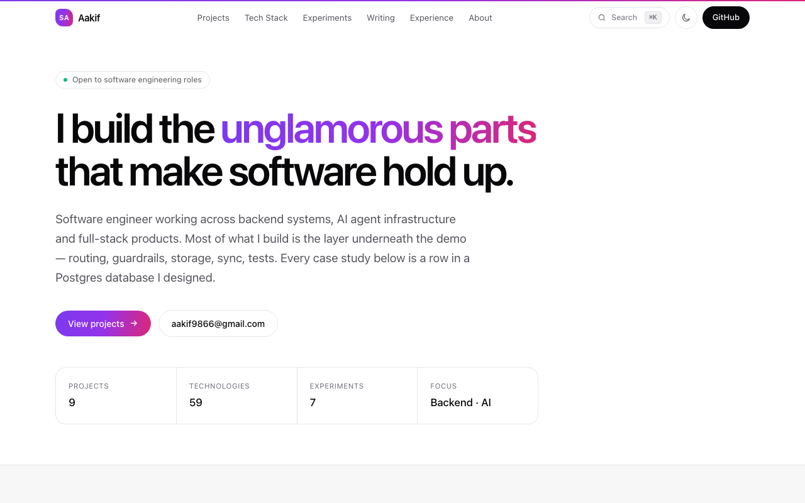
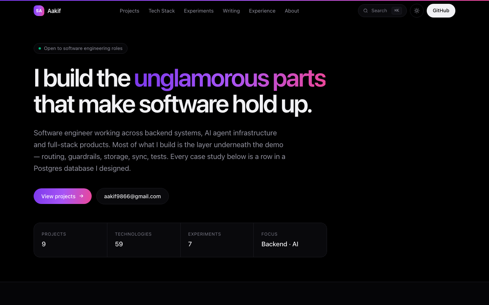
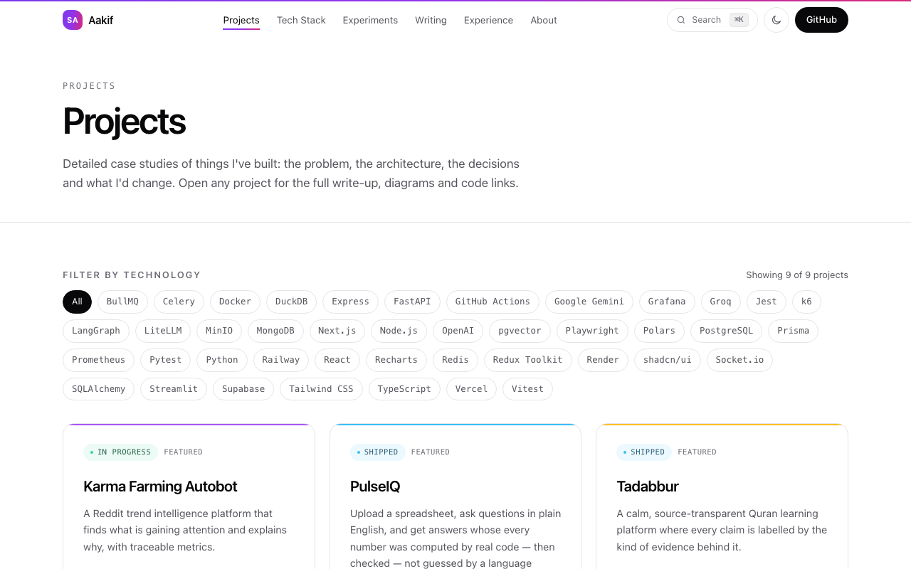
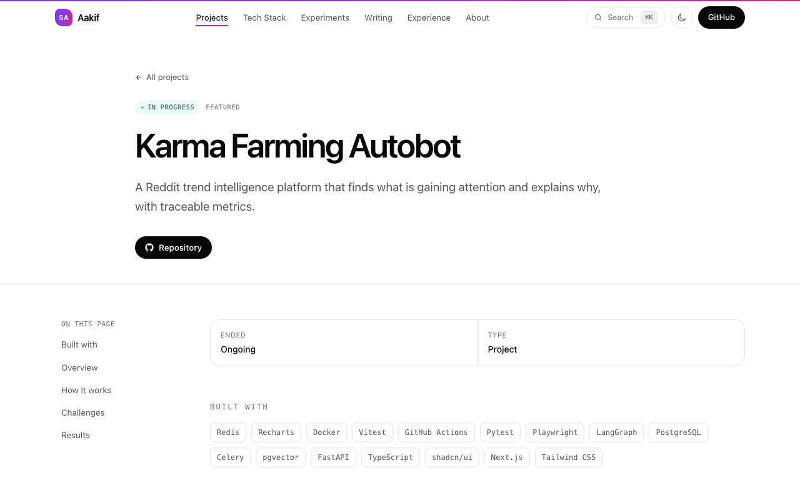

# Aakif — Engineering Portfolio

A personal engineering portfolio and the content management system that runs it.

**Live:** https://portfolio-pi-weld-92.vercel.app

Projects, experiments, technologies, articles and work history are rows in a Supabase
(PostgreSQL) database, edited through a built-in admin at `/admin`. Postgres row-level security
(RLS) decides who can read and write what: visitors see published content only, and only the
allowlisted admin can change anything.

**Stack:** Next.js 15.5 (App Router) · React 19 · Supabase (Postgres + Auth) · Tailwind CSS v4 ·
TypeScript · Vitest · Playwright · deployed on Vercel.

| Home (light) | Home (dark) |
| --- | --- |
|  |  |
| **Projects** | **A case study** |
|  |  |

---

## Running locally

Requires Node 22 and access to the Supabase project.

```bash
npm install
npm run dev        # http://localhost:3000
```

Create `.env.local` with:

| Variable | Used for |
| --- | --- |
| `NEXT_PUBLIC_SUPABASE_URL` | Supabase project URL |
| `NEXT_PUBLIC_SUPABASE_ANON_KEY` | Public (anon) key. Safe in the browser because every table has RLS |
| `SUPABASE_SERVICE_ROLE_KEY` | Server-only. Used **only** by the visit counter in `middleware.ts`. Never prefix with `NEXT_PUBLIC_` |
| `AI_API_KEY` (or `DEEPSEEK_API_KEY`) | Optional. Server-only key for the workspace AI buttons. Without it the buttons are hidden |
| `AI_BASE_URL`, `AI_MODEL` | Optional. Default `https://api.deepseek.com` and `deepseek-chat`; any OpenAI-compatible provider works |
| `AI_MONTHLY_TOKEN_CAP` | Optional. Default 2,000,000; AI calls are refused past it for the rest of the month |

> Running the app locally against the production database counts your page views in the
> production visit counter. Set `SUPABASE_SERVICE_ROLE_KEY` to an invalid value to browse
> without writing anything.

| Script | What it does |
| --- | --- |
| `npm run dev` | Development server |
| `npm run build` / `npm start` | Production build and server. The build prerenders every published project, article and experiment |
| `npm run lint` | ESLint (`next lint`) |
| `npm run typecheck` | `tsc --noEmit` |
| `npm test` | Unit and migration tests (Vitest). No network or database needed |
| `npm run test:e2e` | Visitor smoke tests (Playwright) against `next start`; run `npm run build` first. Reads the real database with the anon key only |
| `node --env-file=.env.local scripts/check-rls.mjs` | Read-only security check against the real database (see [Security](#security)) |

---

## What's on the site

| Route | Shows | Source |
| --- | --- | --- |
| `/` | Introduction, featured projects, technologies by category, recent experiments, contact | several tables |
| `/projects` | All projects, filterable by technology (`?tech=`) | `projects`, `project_technologies` |
| `/projects/[slug]` | Full case study: summary, facts, technologies, write-up sections, architecture diagrams, milestones, with an "On this page" contents list | `projects`, `project_sections`, `architecture_diagrams`, `project_milestones` |
| `/system` | **Tech Stack** — every technology, grouped, each linked to the projects that use it | `technologies` |
| `/lab`, `/lab/[slug]` | **Experiments** — hypothesis and outcome; failed and abandoned ones stay published | `experiments` |
| `/articles`, `/articles/[slug]`, `/articles/tag/[tag]` | **Writing**, the written companion to the YouTube channel: a companion video per post (YouTube links play in a privacy-enhanced player at the top; a YouTube link alone on a line embeds another one in the text), tags with a page each and a tag filter, related posts by shared tags, cover images, share links (X, LinkedIn, Reddit, WhatsApp, copy link), an "On this page" contents list, linkable headings, reading time, code blocks with a copy button, `> [!NOTE]` callouts, image captions, a reading-progress bar and previous/next links. Each post has BlogPosting structured data (with the video) and a social preview: the cover, else the video thumbnail, else a generated card (`/articles/[slug]/og`). RSS at `/feed.xml` (tags as categories), plus `/sitemap.xml` and `/robots.txt` | `articles` (tags, cover and video columns need migration `20261119000003`) |
| `/experience` | Work and education, newest first | `timeline_entries` |
| `/about` | About me, contact, and recent public GitHub repos | `site_config`; the public GitHub API (no token, cached 1 hour, section hidden if GitHub can't be reached) |

Navigation labels live in one place (`src/lib/labels.ts`) and are used by the nav, footer,
headings and search. The command palette (⌘K / Ctrl K, or the search button) jumps to any page,
project, experiment, article or technology. Its index is a cached `/search.json` loaded the first
time the palette opens, so pages don't carry it. Phones get a menu button. Light and dark themes are
applied before the first paint.

Public pages are prerendered and refreshed every 5 minutes (ISR). `/projects` is static too: its
`?tech=` filter runs in the browser (`src/components/tech-filter.tsx`). Middleware does no network
work on public pages: the visit is recorded after the response (`waitUntil`), and the session is
only refreshed on `/admin` and `/login`.

**Measured** (local production build, median of 10 warm requests, 2026-11-18):

| Route | Before v2 | After | HTML before → after |
| --- | --- | --- | --- |
| `/` | 88 ms | 3 ms | 73 → 65 KB |
| `/projects` | 218 ms | 3 ms | 88 → 70 KB |
| `/projects/pulseiq` | 66 ms | 3 ms | 57 → 50 KB |
| `/lab` | 67 ms | 2 ms | 44 → 36 KB |
| `/articles` | 72 ms | 2 ms | 25 → 17 KB |

Time to first byte, server on the same machine, so network latency to visitors is not
included. The "before" time was mostly middleware waiting on the visit counter.

**Case-study sections** come in 17 types (overview, problem, why, how, architecture, data model,
API, frontend, backend, infrastructure, performance, testing, decisions, challenges, results,
future, lessons). They always render in that order, whatever order they were added in, and only
`published` ones are shown.

**Architecture diagrams** can be a hosted image (click for full size), an interactive SVG built
from `nodes`/`edges` JSON, or both. Below 768px the interactive diagram becomes a numbered list.

---

## Admin (`/admin`)

A single admin account; there is no public sign-up. Sign in at `/login`.

| Area | Screens |
| --- | --- |
| **Inbox** (private workspace, the `/admin` home) | A quick-capture box on every admin page (⌘J): paste a link (its title, site and image are fetched) or type a note; `log:` `idea:` `goal:` `job:` set the kind and `#tags` are pulled out. The inbox lists everything with search, kind and tag filters, pinning, and an editor where every field is optional. Export as JSON or Markdown. **Never shown on the public site** |
| **Workspace views** | **Resources**: links by source (YouTube, GitHub, docs, …), a learning queue and one-click status. **Logs**: a timeline by week (IST), filterable by area tag. **Ideas**: a Someday → Next → Active → Dropped board; *Start project* creates a draft project. **Jobs**: add a job with just a role, company or link; a Saved → Applied → Interviewing → Offer board and a list of all jobs; optional details (location, contact, salary range, pasted job description), a follow-up date, notes, and a status history (moving to Applied fills the applied date). Follow-ups due show on the Jobs page and the Inbox, never as notifications. **Career** (strictly private): an optional profile (current and target salary, roles, companies, short- and long-term plans, strategy notes), goals with optional deadlines and `- [ ]` milestones you can tick in place, and at-a-glance counts. Goals connect to resources and logs through shared tags. **Skills**: your public tech list plus private levels, "want to learn" flags and extra skills, with resource counts by tag; the public Tech Stack page is unchanged. **AI help** (optional, DeepSeek by default): buttons in the entry editor to summarise a linked page (saved on the entry), structure a rough log into sections with resume bullets, improve writing, and draft a follow-up or thank-you email for a job. Suggestions are previewed and only replace your notes if you accept. Prompts use only that entry, never the career profile or salary; usage is capped per month. **Resume** (private): a master profile drafted from your published projects, experience and tech stack (anything the portfolio doesn't know is a highlighted [placeholder], nothing invented), plus versions for specific roles, optionally tied to a job. Edited as plain text with a live preview in a Jake's Resume-style layout; **PDF** through the browser's Print (selectable text, so applicant-tracking systems can read it) and **.tex** for Overleaf. With AI on, *Tailor to the job* reorders and rewords bullets against the job's pasted description and lists missing keywords; it never sends your name or contact line. Accepted resume bullets from logs are offered for copying. **Weekly recap**: what was logged, saved, finished and achieved that week. The Inbox also shows at-a-glance counts and links to PLOS for daily to-dos |
| **Site dashboard** (`/admin/site`) | Published / draft / archived counts per content type, a "needs attention" list (drafts, case studies missing key pieces), recent changes, quick actions, total page views |
| **Content** | Projects · Articles · Experiments · Experience |
| **Project builder** | Case-study sections · Architecture diagrams · Milestones · Technologies, across all projects |
| **Media** | Upload, copy the link of, and delete files in Supabase Storage |
| **Settings** | The site content the public pages read (About text, contact email, GitHub, LinkedIn), and account and access information |

**Project workspace** (`/admin/projects/[id]`) puts everything for one project in tabs:
Overview · Case study · Technologies · Architecture · Milestones · Publishing. The Publishing tab
has the status controls, a Preview link and a checklist of suggestions. The suggestions never
block publishing.

**Publishing states**

| State | Meaning |
| --- | --- |
| Draft | Not visible on public pages |
| Published | Visible on public pages |
| Archived | Kept for reference; not shown publicly |

Case-study sections can also be **Hidden**. Only valid next actions are offered (Publish,
Unpublish, Archive, Restore), and the server rejects any other transition.

**Previews** (`/admin/projects/[id]/preview`, `/admin/articles/[id]/preview`) render drafts with
the admin's own session, so a draft is never publicly reachable.

**Markdown fields** use one editor: Write / Preview / Split, a formatting toolbar, ⌘B ⌘I ⌘K ⌘S, and images pasted or dropped straight into Storage. The preview uses the public renderer and loads only when opened.

**Forms** are generated from one definition per table in `src/lib/admin-fields.ts`: labels, help
text, required fields, and advanced settings that start collapsed. The same definition is the
server's allowlist. A save can only write the listed columns, and slugs, links, dates and
dropdown values are validated on the server. `state`, `published_at`, `id` and timestamps can't
be set through a normal save. Deletes and revision restores ask for confirmation, and forms warn
about unsaved changes.

**Article revisions:** every article save first stores the previous title and body, and any
revision can be restored. A restore is itself a save, so it can be undone.

---

## Security

The threat model (assets, actors, boundaries, and the test behind each mitigation) is in
[SECURITY.md](SECURITY.md). Design decisions are recorded in [docs/adr/](docs/adr/):
[RLS as the boundary](docs/adr/0001-rls-is-the-authorization-boundary.md),
[the query wrapper](docs/adr/0002-public-queries-go-through-fetchorthrow.md),
[Server Actions](docs/adr/0003-server-actions-for-a-single-writer-cms.md) and
[ISR settings](docs/adr/0004-isr-every-five-minutes-plus-on-demand-revalidation.md).

Three layers protect the admin. Only the last one is authoritative:

1. **`src/middleware.ts`** redirects signed-out requests away from `/admin`. A convenience.
2. **`requireAdmin()`** (`src/lib/auth.ts`) runs again on the server in every admin page and
   server action. It requires a session *and* an `admin_allowlist` row.
3. **Postgres RLS** calls `is_admin()`, which checks `profiles.role = 'admin'`. That role is set at
   sign-up, only for an email in `admin_allowlist`. If the first two layers were removed, a signed-out
   client still could not read a draft or write a row.

Admin membership is a database row, not a client-side flag or a token claim the browser could
change.

**Three Supabase clients** (`src/lib/supabase/server.ts`):

| Client | Key | Used by | Effect |
| --- | --- | --- | --- |
| `supabasePublic()` | anon, no cookies | public pages | Sees published rows only; responses are cacheable |
| `supabaseServer()` | anon + the user's session cookie | admin pages, server actions | Postgres applies RLS as the signed-in user |
| `supabaseService()` | service role | the visit counter only | Bypasses RLS; server-only |

**`scripts/check-rls.mjs`** is a read-only check against the real database. It only runs
`SELECT`s and confirms:
- signed-out users see published projects
- no unpublished rows are visible in any table with a state
- children of unpublished projects are hidden
- `admin_allowlist`, `article_revisions` and `profiles` are private
- signed-out users can't list files in the `media` storage bucket

It never inserts, updates or signs in. Some checks are skipped when the database has no draft
projects to test against.

**Security headers** (`next.config.ts`):
- a Content Security Policy
- HSTS
- `X-Frame-Options: DENY`
- `nosniff`
- a strict referrer policy
- a Permissions-Policy that turns off camera, microphone and location

---

## Reliability

**No empty pages from database failures.** Every public query goes through `fetchOrThrow`
(`src/lib/db.ts`).

- A successful query with zero rows is a real empty state and renders as one.
- Timeouts and network errors are retried: 3 attempts, 8 seconds each, with a short back-off.
  Query errors are not retried.
- A query that still fails throws `Couldn't load … from the database.`:
  - **During `next build`**, the build fails, and Vercel keeps the previous deployment.
  - **During a 5-minute refresh**, Next keeps serving the last good page.
  - **On a first render**, `app/error.tsx` shows a retry page (`global-error.tsx` if the layout itself failed).
- Logs record only the query name, an error code and the attempt count. No URLs, keys or
  database messages.

A test fails if a public page adds a query that bypasses `fetchOrThrow`.

**Visit counter.** The site tracks one number: total page views, stored in
`site_config.visit_count`. It stores no IPs, user agents or per-visitor data, and uses no
third-party analytics. `middleware.ts` adds one per real page view, after the response is sent, via one atomic
`increment_visit_count()` call. Admin pages, the login page
and link prefetches aren't counted. If the count can't be read, it is hidden rather than shown
as 0.

---

## Tests

`npm test` runs 251 tests, offline:

| File | Covers |
| --- | --- |
| `tests/admin-rules.test.ts` | Form parsing, field allowlist, validation (slugs, links, dates, options), publishing transitions |
| `tests/db-fetch.test.ts` | Zero rows vs. failure, retry limits, which errors are retried, no data leaking into logs, every public query uses `fetchOrThrow` |
| `tests/settings-usage.test.ts` | The site only reads settings the admin can edit, and every editable setting is used |
| `tests/migration-atomic.test.ts` | The atomic reorder/revision migration's SQL, run against a real Postgres engine (PGlite) with simplified tables |
| `tests/migration-visits.test.ts` | The visit-counter migration: one per call, first-use insert, service-role only |
| `tests/media.test.ts` | Upload checks: type from magic bytes (no SVG), size limit, generated paths, path validation |
| `tests/entries.test.ts` | Quick-capture parsing, the workspace save allowlist, link-preview parsing and the private-host guard, Markdown export |
| `tests/migration-workspace.test.ts` | The workspace tables in PGlite: admin-only RLS, non-admins and anon locked out, shape constraints, `updated_at` |
| `tests/career.test.ts` | Career profile and skill allowlists, milestone checklist counting and toggling |
| `tests/ai.test.ts` | The AI client (request shape, error mapping without echoing bodies, no call without a key), monthly usage, prompts (fenced untrusted input, no salary in emails) |
| `tests/resume.test.ts` | Resume format parsing, placeholders, the portfolio-based starter (no invented facts), log bullets, LaTeX escaping and export |
| `tests/markdown.test.ts`, `tests/markdown-render.test.ts` | Heading slugs and TOC extraction (ids match the rendered headings), reading time, callouts, RSS escaping, renderer output, no raw HTML |
| `tests/privacy.test.ts` | No file outside `src/app/admin` queries a private table; no client component imports the AI helper; no public AI key |

There are no browser end-to-end tests and no CI workflow yet. The admin flows are verified by
hand.

---

## Data model

The schema predates this repo and lives in Supabase; there is no baseline migration in
`supabase/migrations` yet.

| Table | Role |
| --- | --- |
| `projects` | Case studies: `state` (draft/published/archived), `status` (in progress/shipped/…), ordering, links |
| `project_sections` | Write-up sections, 17 types, each with its own state |
| `architecture_diagrams` | `nodes`/`edges` JSON and/or `image_url` |
| `project_milestones` | Dated timeline entries per project |
| `technologies`, `project_technologies` | Tech Stack page and per-project tags |
| `articles`, `article_revisions` | Articles and their saved versions |
| `experiments` | Experiments |
| `timeline_entries` | Work and education |
| `site_config` | Key/value site content (`key` is the primary key), plus `visit_count` |
| `admin_allowlist` | Who may become admin: sign-up gives these emails `profiles.role = 'admin'`, which RLS checks |
| `entries`, `private_config` | The private workspace. Admin-only RLS, no anon grants, never read by a public page |

`topics`, `tags`, `claims`, `sources` and a few other tables exist in the schema but aren't used
by the app.

---

## Deployment

The site is deployed on Vercel. The project `portfolio` is connected to this GitHub repository:

- **A push to `main`** deploys to production.
- **Other branches** get preview deployments, which are protected by Vercel login.

Environment variables are set in Vercel for production and preview (the service-role key is
marked sensitive). The Supabase project is hosted separately; deploying the app never changes
the database.

---

## Known limitations and pending work

Details for all of these are in [docs/maintenance.md](docs/maintenance.md).

- **11 unused `site_config` settings** from an earlier design remain (the 9 obsolete ones were
  removed), shown read-only in Admin → Settings. The audit is in `docs/maintenance.md` §2.
- **Uploads** (Admin → Media, and an Upload button on the hero and diagram image fields) store
  files in the public `media` bucket: PNG, JPEG, GIF, WebP, AVIF or PDF, up to 4 MB, type checked
  from the file's bytes. Only the admin can upload, list, replace or delete (storage RLS).
- **Not built:**
  - browser tests for admin journeys (the visitor smoke tests exist; admin ones need a test account)
  - error monitoring (server errors appear in Vercel's logs)

---

## Repository layout

```
src/
  app/                  routes (public pages, /admin, /login, error pages)
    admin/              admin screens, server actions (actions.ts), shared admin UI (ui.tsx)
  components/           shared UI: nav, footer, case study, diagram, command palette, …
  lib/
    supabase/           the three Supabase clients
    admin-fields.ts     admin form definitions + server-side validation
    db.ts               fetchOrThrow: retries and failure handling for public queries
    form.ts             form parsing, publishing transitions
    labels.ts           navigation and status vocabulary
    contact.ts, site-content.ts   settings the site reads
  middleware.ts         session refresh, /admin redirect, visit counter
supabase/migrations/    schema changes since the dashboard-created base (all applied 2026-11-19)
scripts/check-rls.mjs   read-only security check
tests/                  Vitest tests; tests/e2e/ Playwright smoke tests
.github/workflows/ci.yml lint, typecheck, test; build + e2e only if Supabase secrets are set
docs/maintenance.md     migration runbook, settings audit
```
